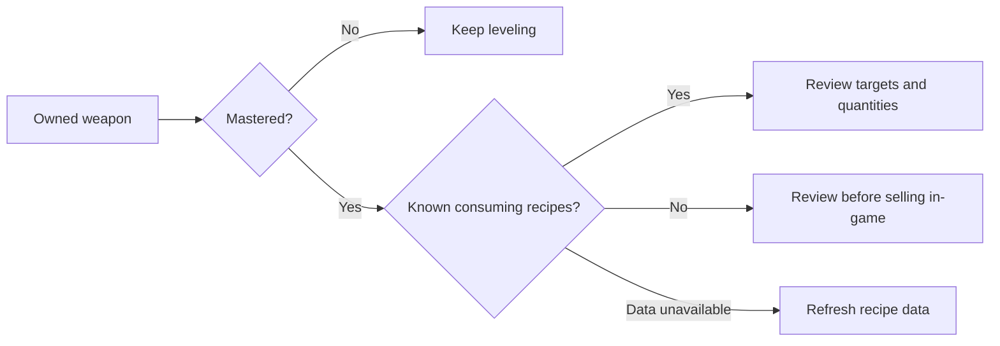
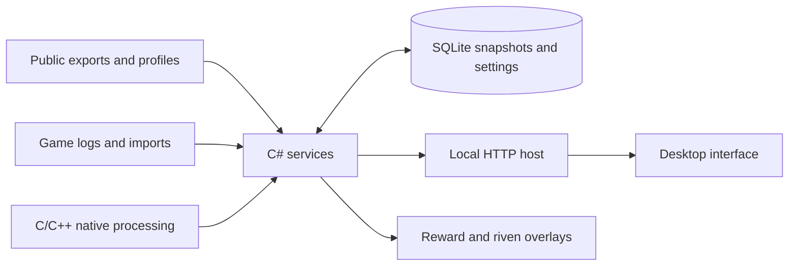

<div align="center">

# Warframe Companion

**Inventory, mastery, crafting and mission rewards in one desktop app.**

[](https://github.com/Lenalein2001/Warframe-App/actions/workflows/companion.yml)
[](https://github.com/Lenalein2001/Warframe-App/actions/workflows/windows.yml)
[](LICENSE)

[Features](#features) · [Get the app](#get-the-app) · [Build](docs/DEVELOPMENT.md) · [Validation](docs/migration/VALIDATION.md)

</div>

A C# desktop host and application services, with C/C++ for process reading, image processing and export decoding. The established interface is retained, with focused additions for inventory review. Existing accounts, settings and inventory migrate without modifying the original files.

## Features

| Area | What it does |
| --- | --- |
| **Inventory** | Search stacks and equipment; filter weapons, mastery and crafting uses. Open an item to see what consumes it and follow recipe chains. |
| **Mastery & collection** | Track equipment mastery, prime sets, relics, missing parts and pinned items. |
| **Crafting & farming** | Review foundry jobs, materials, drop locations and saved farming plans. |
| **Mission rewards** | Recognize relic rewards, compare market values and show an in-game overlay. |
| **Rivens & markets** | Grade rolls, decode explicit fingerprints and look up market prices. |
| **World & standing** | Browse fissures, cycles, events, syndicates and available offers. |
| **Accounts & storage** | Keep accounts isolated, retain history and reject stale or incomplete inventory replacements. |

### Keep weapons needed for crafting

In **Inventory**, combine **Weapons**, **Mastered** and **No known crafting uses**, or use the one-click review button. Weapons consumed by another recipe remain marked even when the resulting weapon has already been mastered.



“No known crafting uses” describes the loaded recipes, not a sale recommendation. Mastery is account-wide; upgrades, loadouts and individual copies still matter. The companion never sells items.

## Get the app

Current builds are in the **WarframeCompanion-win-x64** artifact of a successful [Windows packages run](https://github.com/Lenalein2001/Warframe-App/actions/workflows/windows.yml?query=branch%3Asenpai). GitHub requires sign-in to download workflow artifacts. Historical releases may contain the previous app; a final replacement release has not yet been published.

| Windows package | Choose it when |
| --- | --- |
| **Setup.exe** | You want a per-user installation, Start menu entry and uninstaller. |
| **Self-contained ZIP** | You want the .NET runtimes included. |
| **Framework-dependent ZIP** | .NET 10 and ASP.NET Core 10 are already installed. |

All editions require WebView2 and include the OCR fallback. Run the executable for normal storage or `Portable.cmd` for data beside the app. See [usage](docs/USAGE.md).

Removing unused legacy OCR data reduces the framework-dependent ZIP to approximately **24 MiB**, and the self-contained ZIP to **71 MiB**, while retaining the original LSTM model and dictionaries. The launcher is about 159 KiB; most package space is runtime libraries and OCR dependencies. Exact measurements and test conditions are in [validation](docs/migration/VALIDATION.md).

## Data flow



Inventory capture prioritizes public data, logs, imports and optional read-only memory access. Reward choices and on-screen riven cards retain OCR where a reliable direct source is unavailable. Memory capture is disabled by default. The app does not modify or inject into the game process.

## Development

```text
src/          C# projects and native C/C++ libraries
web/          Desktop interface assets
tests/        Managed integration and native regression tests
packaging/    Windows installer and Linux desktop integration
tools/        Build, packaging, verification and benchmarking scripts
docs/         Usage, development and validation notes
licenses/     Third-party notices
```

Windows requires .NET SDK 10, Visual Studio C++ Build Tools with CMake, and WebView2.

```powershell
./tools/build-native.ps1
dotnet build WarframeCompanion.slnx -c Release -p:RestoreLockedMode=true
dotnet run --project tests/WarframeCompanion.Tests -c Release
python tools/migration-contracts.py --check
dotnet run --project src/Desktop -c Release
```

Linux supports source builds through `./run.sh` and Nix through `default.nix`. See [development instructions](docs/DEVELOPMENT.md) for dependencies, CLI commands, packaging and benchmarks.

Windows and Ubuntu builds, native tests and the Nix package are checked in CI. Windows packages also undergo startup, restart, install, upgrade and uninstall checks. Linux desktop/compositor behavior and all live-game lifecycle combinations remain separate manual checks.

## Credits & license

Derived from [Diskutabell/Warframe-App](https://github.com/Diskutabell/Warframe-App), retaining its interface and functionality. Data comes from Digital Extremes and community projects including WFCD and warframe.market. Third-party notices are in [licenses](licenses).

An independent fan project, not affiliated with Digital Extremes. Distributed under the [MIT license](LICENSE). See [CHANGELOG](CHANGELOG.md) for historical release notes.
