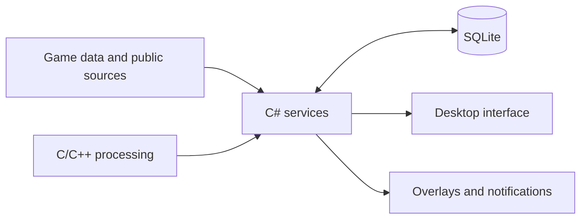

<div align="center">

# Warframe Companion

Inventory, mastery, crafting and mission rewards in one desktop app.

[](https://github.com/Lenalein2001/Warframe-App/actions/workflows/companion.yml)
[](https://github.com/Lenalein2001/Warframe-App/actions/workflows/windows.yml)
[](https://github.com/Lenalein2001/Warframe-App/actions/workflows/linux.yml)
[](LICENSE)

[Download](https://github.com/Lenalein2001/Warframe-App/releases/latest) · [Usage](docs/USAGE.md) · [Development](docs/DEVELOPMENT.md) · [Report a bug](https://github.com/Lenalein2001/Warframe-App/issues)

</div>

Warframe Companion brings collection progress, crafting information and reward comparisons together without leaving your desktop. It runs on Windows and Linux, with separate accounts, persistent settings and optional in-game overlays.

## Features

| | |
| --- | --- |
| **Inventory** | Search equipment and resources, filter by mastery and trading status, and see which recipes consume an item. |
| **Collections** | Track mastery, prime sets, relics, missing parts and pinned items. |
| **Crafting and farming** | Review foundry jobs, required materials, drop locations and saved farming plans. |
| **Relic rewards** | Compare recognized rewards, ownership and market values in an overlay. |
| **Rivens and markets** | Grade rolls, decode explicit riven fingerprints and look up market prices. |
| **World and standing** | Browse fissures, cycles, events, syndicates and offers. |
| **Desktop integration** | Receive native notifications and use shortcuts for common actions. |

### Review mastered weapons

The inventory's **Review mastered weapons** filter shows mastered weapons with no known consuming recipes. Open an item to inspect its crafting uses, required quantities, target ownership and mastery, then follow the recipe chain.

Recipe information reflects the loaded catalog. Mastery is account-wide; individual copies, upgrades and loadouts still matter. The app never sells items for you.

## Installation

Download packages from [GitHub Releases](https://github.com/Lenalein2001/Warframe-App/releases/latest). All published builds target **x86-64**.

### Windows

- **Installer:** run `WarframeCompanion-win-x64-Setup.exe` for a per-user installation and Start menu shortcut.
- **Portable:** extract the self-contained ZIP and run `Portable.cmd` to store data beside the app. Run `WarframeCompanion.Desktop.exe` instead to use your normal user profile.
- **Smaller download:** the framework-dependent ZIP requires the .NET 10 and ASP.NET Core 10 runtimes. The self-contained edition includes them.

Windows requires WebView2. Both editions include the English OCR fallback. The framework-dependent ZIP is approximately 13 MB; the self-contained ZIP is approximately 63 MB.

### Linux

The native Linux app runs alongside Warframe through Steam/Proton; the companion itself does not need Proton.

**Ubuntu 24.04 / Linux Mint 22:** install the Debian package with dependency resolution:

```sh
sudo apt install ./WarframeCompanion-linux-x64.deb
warframe-companion
```

**Portable:** extract `WarframeCompanion-linux-x64-portable.tar.gz` into a writable folder and run `./Portable.sh`. The .NET runtime is included; GTK 3, WebKitGTK 4.1, GTK Layer Shell, libnotify, fontconfig, ICU, OpenSSL and English Tesseract must be supplied by your distribution. Screenshot tools depend on the session: scrot/maim for X11, Spectacle for KDE, GNOME Screenshot for GNOME, or grim for wlroots compositors.

**Nix:** use `nix-build` and launch `./result/bin/WarframeCompanion.Desktop`. See [development](docs/DEVELOPMENT.md) for details.

Ubuntu and Nix desktop startup, notifications and X11 overlays are tested in CI. Live Warframe under Proton and the Wayland compositor matrix remain unverified. Wayland screenshot permissions and overlay support vary by desktop; the main app remains available when an overlay is unsupported.

## Data and recognition

Settings and account data are stored outside the installation directory by default:

| Platform | Location |
| --- | --- |
| Windows | `%LOCALAPPDATA%\WarframeCompanion` |
| Linux | `$XDG_DATA_HOME/WarframeCompanion`, or `~/.local/share/WarframeCompanion` |
| Portable | `data/` beside the executable |

Updates and uninstallers preserve user data. Back up the data folder before moving profiles between machines. Existing legacy data is copied on first normal startup without changing the original files.

Inventory data comes from public exports, profiles, logs, imports and optional read-only process capture. Memory capture is disabled by default. Reward choices and on-screen riven cards use OCR when a reliable direct source is unavailable. The app does not modify or inject into the game process.

See [usage](docs/USAGE.md) for account setup, notifications and command-line options.

## Architecture and development

C# handles application services, persistence and the desktop host. C/C++ handles process reading, image processing and export decoding. The interface uses local HTML, CSS and JavaScript in the system webview.



```text
src/          C# projects and C/C++ libraries
web/          Interface assets
tests/       Maintained regression and integration tests
packaging/    Windows and Linux installation files
tools/        Build, packaging and verification scripts
docs/         Usage and development documentation
licenses/     Third-party notices
```

Build instructions and test commands are in [DEVELOPMENT.md](docs/DEVELOPMENT.md). Bug reports should include the app version, operating system, reproduction steps and relevant errors. Remove account identifiers and private data from logs before sharing them.

## License and acknowledgements

[MIT](LICENSE). Third-party license notices are included in [licenses](licenses/) and the distributed packages. This project builds on the original [Warframe-App](https://github.com/Diskutabell/Warframe-App) interface and functionality.

Warframe is a trademark of Digital Extremes. This is an independent community project and is not affiliated with or endorsed by Digital Extremes.
